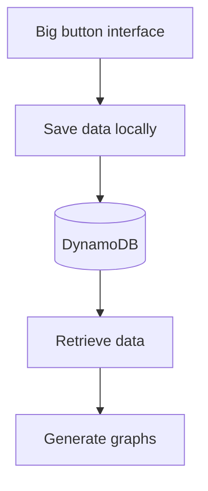

Big button interface for easy input by coaches on poolside. 

“Users: coaches only for the prototype. Parked: parents (data entry for own child; would reuse the coach–swimmer link pattern) and swimmers (MySwimPro etc. cover this). Media: optional and consent-gated; presigned POST to private S3; after auth.”

Maybe: “Later (after auth): per-coach custom protocol buttons, stored as data. Each has a stable ID, a renameable label and an optional base category, so history and cross-coach analysis stay intact. Coaches can reorder and hide buttons.”

Note: “Parked: coaches add and manage their own swimmers (needs auth and coach–swimmer links). Prototype uses hard-coded mock swimmers; testers get test- IDs.”

---

## Decision records (authored by Claude)

*Written by Claude (Opus 5.5) on 19 October 2026, from the code and the conversations where these decisions were made. Everything above this line is Fiona's.*

Each record is short: what prompted it, what was decided, and what follows from it. When a decision changes, add a new record that replaces the old one rather than editing it, so the reasoning stays visible.

### ADR 1: The iPad chooses session IDs, and saves are idempotent

**Status:** Accepted, 16 October 2026

**Context.** Pool Wi-Fi is unreliable. When a save fails, the app can't tell whether the request was lost (nothing saved) or the response was lost (everything saved). The first version had the server name each session after its own clock, so retrying after a lost response created a second copy of the same session.

**Decision.**
- The frontend creates the session ID when the first rep is added (`2026-10-16T16:17:19.123Z-a1b2c3`: an ISO UTC timestamp plus 6 random characters) and keeps it until End session.
- Each rep gets a `repNumber` when it's added.
- The backend writes the session and its reps with plain Puts inside one DynamoDB transaction, with no "only if new" condition.

**Consequences.**
- Sending the same session again overwrites the items with identical data, so a retry is always safe, even when the first attempt succeeded.
- The transaction saves all of a request's items or none, so there are no half-saved sessions.
- Saves time out after 15 seconds, so a dead connection becomes a retryable error rather than an endless "Saving…".
- Puts never delete: a rep that was saved but whose response was lost, and was then undone, stays in the table until a new rep with the same number overwrites it.
- The random suffix stops two devices that start a session in the same millisecond from clashing.

### ADR 2: One DynamoDB table, keyed by swimmer then session

**Status:** Accepted, 16 October 2026

**Context.** The main question the data needs to answer is "show me this swimmer's sessions and reps", for charts later on.

**Decision.** A single table:

| Item | PK | SK | Other attributes |
|---|---|---|---|
| Session | `SWIMMER#<swimmerId>` | `SESSION#<sessionId>` | `type`, `swimmerId`, `startedAt` |
| Rep | `SWIMMER#<swimmerId>` | `SESSION#<sessionId>#REP#007` | `type`, `repNumber`, `protocol`, `rate`, `time`, `tags`, `note` (only when set) |

**Consequences.**
- One query on a swimmer's `PK` returns all their sessions with each session's reps straight after it, already in date order. This works because the session ID starts with an ISO timestamp, which sorts correctly as text.
- Rep numbers are zero-padded to 3 digits so they sort as text: `002` before `010`. That caps a session at 999 reps.
- A DynamoDB transaction holds at most 100 items, so one request can carry at most 99 reps (plus the session item). A coach saving as they go won't reach this.
- `startedAt` is the timestamp part of the session ID, stored separately so it can be read without parsing the ID.

### ADR 3: Static frontend on Cloudflare, API on AWS

**Status:** Accepted, in place by 15 October 2026

**Context.** *(Reasons from Fiona.)* This is a personal learning project that will go on a CV and be discussed at job interviews, so low cost and relevant skills both matter.
- **Cloudflare:** the project needed its own domain, which looks cleaner when people are testing it and keeps things tidy. `swimmerdata.dev` was available through Cloudflare at a low price. With the domain bought there, hosting the frontend on Cloudflare too was the natural next step, and it's good value for money.
- **AWS:** used in a previous job. Building the backend on it keeps those skills current and gives a solid, widely used platform to talk about. A free tier account keeps the cost down.

**Decision.**
- The frontend is a static Vite build, served by Cloudflare Workers as static assets (`frontend/wrangler.jsonc`) and deployed by hand with `npx wrangler deploy`.
- The backend is an API Gateway HTTP API, a Python 3.13 Lambda and DynamoDB in `eu-west-2`, all defined in Terraform (`infra/`).
- Terraform zips only `backend/handler.py`, so tests and dev requirements never reach the Lambda.

**Consequences.**
- There are two separate deploys. Pushing to GitHub deploys neither.
- When a change affects the request format, deploy whichever side still accepts the other's old requests first, so saving keeps working in between.
- The browser calls AWS from a Cloudflare page, so the API's CORS settings must list each site address that calls it. They currently allow `https://swimmerdata.dev` and `http://localhost:5173` only, and the unused workers.dev address is deliberately left out.
- CORS limits which websites can call the API from a browser, but it isn't access control: until there's a login, anyone who finds the API's address can write to it.

### ADR 4: The protocol list lives in two places, for now

**Status:** Accepted, 16 October 2026

**Context.** The frontend needs the protocols to draw the buttons, and the backend needs them to reject unknown values.

**Decision.** Keep two copies, `PROTOCOLS` in `frontend/src/lib/protocols.ts` and in `backend/handler.py`, with a comment beside each pointing to the other.

**Consequences.**
- It's simple, with no shared file or build step between TypeScript and Python.
- The copies can drift apart. They already did once: the buttons were renamed (All out, 50/100/200 pace) but the backend kept the old names, so most saves failed with "unknown protocol" until it was fixed on 16 October.
- This should be replaced by the per-coach protocol buttons stored as data (Fiona's note above). At that point the database becomes the single source of truth.

### ADR 5: Saved reps stay listed until End session

**Status:** Accepted, 16 October 2026 (replaces clearing the list after each save)

**Context.** Clearing the list after each save hid what the coach had already recorded. It also caused a numbering problem: a rep added during a save could become Rep 1 again and overwrite the rep that had just been saved.

**Decision.**
- Each rep stores its `repNumber` and a `saved` flag.
- Submit sends only unsaved reps and ticks exactly those once the save succeeds.
- Undo can only remove the last rep, and only if it's unsaved.
- End session clears the list and the session ID, so the next rep starts a new session at Rep 1.

**Consequences.**
- A new rep's number is always the last rep's number + 1. Because only an unsaved last rep can be removed, the list is always numbered 1, 2, 3… with no gaps, and a saved rep's number is never given to a different rep.
- Coaches can save as they go, and add reps while a save is in progress.
- The session lives only in the page, so a refresh loses unsaved reps and the session ID. Keeping it in the browser is on the roadmap.
