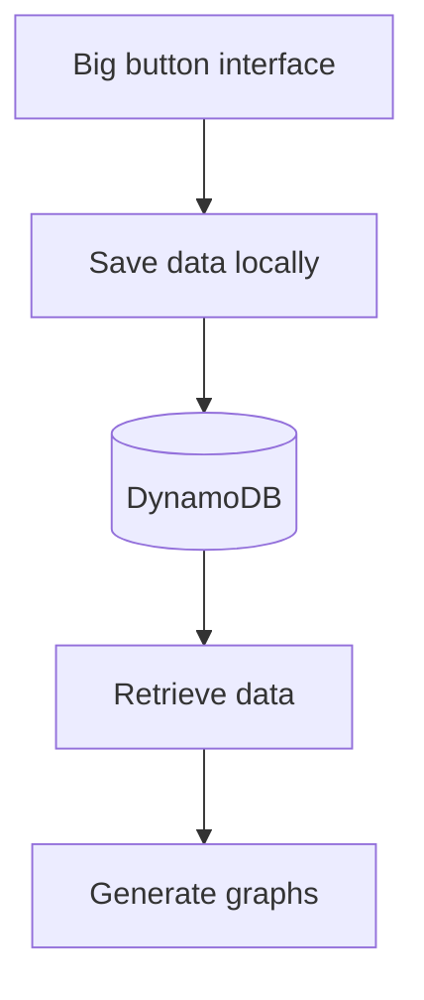

Big button interface for easy input by coaches on poolside. 

“Users: coaches only for the prototype. Parked: parents (data entry for own child; would reuse the coach–swimmer link pattern) and swimmers (MySwimPro etc. cover this). Media: optional and consent-gated; presigned POST to private S3; after auth.”

Maybe: “Later (after auth): per-coach custom protocol buttons, stored as data. Each has a stable ID, a renameable label and an optional base category, so history and cross-coach analysis stay intact. Coaches can reorder and hide buttons.”